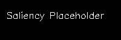

# DeepSteer-Vis: Robust Behavioral Cloning with Saliency Visualization

**DeepSteer-Vis** is an advanced autonomous driving agent trained using **Behavioral Cloning**. It leverages a modified **NVIDIA PilotNet** architecture with **Hyper-Regularization** to drive a car in the Udacity Simulator. 

Crucially, this project features a **Visual Explainability Layer** (using **Grad-CAM**) that overlays a real-time heat map on the driving view, showing exactly *what* the model is looking at (e.g., lane lines, road boundaries).



## 🚀 Key Features

*   **Behavioral Cloning**: Maps raw pixels to steering angles using a deep CNN.
*   **Hyper-Regularization**: Extensive use of Dropout layers to prevent overfitting on simple track textures.
*   **Visual Explainability**: Real-time **Grad-CAM** overlay to visualize the model's focus.
*   **Robust Data Pipeline**:
    *   3-Camera Augmentation (Center, Left, Right).
    *   YUV Color Space Conversion.
    *   Dynamic Cropping & Resizing.
    *   Random Flips & Brightness Adjustments.

## 🛠️ Installation

1.  **Clone the Repository**:
    ```bash
    git clone https://github.com/pronzzz/self-driving-car-simulation.git
    cd self-driving-car-simulation
    ```

2.  **Install Dependencies**:
    ```bash
    pip install -r requirements.txt
    ```

3.  **Udacity Simulator**:
    Download the [Udacity Self-Driving Car Simulator](https://github.com/udacity/self-driving-car-sim).

## 🏎️ Usage

### 1. Training the Model
If you want to train the model from scratch:
1.  Collect training data using the Simulator (Training Mode) and save it to `data/`.
2.  Run the training script:
    ```bash
    python model.py
    ```
    This will generate `model.h5`.

### 2. Autonomous Driving
To let the model drive the car:
1.  Start the drive server:
    ```bash
    python drive.py model.h5
    ```
2.  Launch the Simulator and select **Autonomous Mode**.
3.  The car will start driving! Check the "DeepSteer-Vis" window for real-time Saliency Maps.

### 3. Visualization Tool
To generate a static Saliency Map for a specific image:
```bash
python visualize_activation.py model.h5 path/to/image.jpg
```

## 🧠 Model Architecture

The model is based on **NVIDIA's PilotNet**, modified with **Hyper-Regularization (Dropout)** after every layer.

*   **Input**: 66x200x3 (YUV)
*   **Conv Layers**: 5 (3 Strided, 2 Non-Strided)
*   **Dense Layers**: 100 -> 50 -> 10 -> 1
*   **Regularization**: Dropout (0.5) after each layer.

For more details, check the [Developer Guide](GUIDE.md).

## 📄 License

This project is licensed under the MIT License - see the [LICENSE](LICENSE) file for details.
